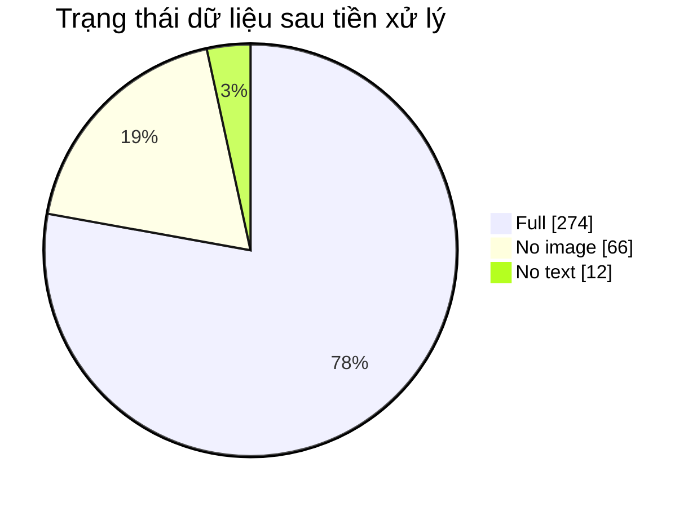

# DATA VALIDATION — BÁO CÁO KIỂM ĐỊNH VÀ BÀN GIAO DỮ LIỆU

**Dự án:** Anti Fake News – Multimodal Fake News Detection  
**Dataset:** FakeNewsNet (PolitiFact, GossipCop)  
**Dependency:** [AFN-005 – Preprocessing](https://github.com/ngnsusinn/anti-fake-news/issues/5)  
**Đầu ra:** `validation_data.md`  
**Trạng thái nghiệm thu:** `PENDING_EVIDENCE` — đã ghi nhận checksum manifest; chưa xác minh checksum toàn batch.

## 1. Mục tiêu và phạm vi

Tài liệu hợp nhất kết quả khảo sát trước/sau tiền xử lý với các yêu cầu kiểm định tính hợp lệ, truy vết, chuẩn ảnh API và bàn giao cho Event Grouping. Không sử dụng dự đoán mô hình, confidence hay điểm tương đồng CLIP làm căn cứ loại mẫu. Phạm vi là batch thu thập 358 mẫu, không đại diện toàn bộ FakeNewsNet.

### 1.1. Nguồn bằng chứng

| Mã | Tài liệu | Vai trò |
|---|---|---|
| E01 | `report.txt` | Thống kê Before, mục 01–09 |
| E02 | `report(1).txt` | Thống kê After, mục 01–09 |
| E03 | `PREPROCESSING_ASSESSMENT.md` | Baseline và tiêu chí đề xuất |
| E04 | `POST_PREPROCESSING_ASSESSMENT.md` | Phân tích đối chiếu |
| E05 | Code/config, commit và log thực thi AFN-005 | Chưa cung cấp; đã có code analyzer `analyzeData(1).py`, không phải preprocessing |
| E06 | Manifest Before/After và ảnh thực tế | Chưa cung cấp |
| E07 | API contract và kết quả kiểm định từng ảnh | Chưa cung cấp |
| E08 | `statistics.json` (before) | Thống kê và hash đầu vào/đầu ra |
| E09 | `statistics(1).json` (after) | Thống kê, hash manifest và báo cáo |
| E10 | Xác nhận của thành viên thực hiện | 6 mẫu bị loại vì thiếu cả Text và Image; chưa có log xác nhận từng mẫu |

Yêu cầu nghiệm thu được lấy từ nội dung issue do người dùng cung cấp; chưa kiểm tra độc lập toàn bộ issue hay repository. Hai báo cáo thống kê không thay thế audit từng mẫu. Các quy tắc bổ sung dưới đây là đề xuất nghiệm thu, không phải khẳng định implementation hiện có.

### 1.2. Phương pháp và quy ước

Hai phiên phân tích cùng phiên bản, cấu hình và thư viện; đo ảnh trên frame đầu, EXIF transpose, alpha nền trắng, RGB/gray 8-bit, không resize. Độ sáng là mean gray, tương phản là độ lệch chuẩn gray, sắc nét là variance Laplacian, noise là proxy MAD high-pass, entropy là Shannon base 2. Các ngưỡng short_words, small_side, text_hamming và image_hamming đều null. Cả hai phiên hoàn thành không có cảnh báo thực thi.

Quy ước: Δ = After − Before; tỷ lệ tính theo mẫu số của từng phiên, chênh lệch tỷ lệ tính bằng điểm phần trăm (đpt). Không coi null/unknown là 0. Thống kê văn bản Before có tính độ dài 0 cho mẫu thiếu, After loại null khỏi phép đo; thống kê ảnh có tập mẫu thay đổi. Do đó so sánh tổng hợp không phải phép đo ghép cặp trên cùng sample_id. Không suy ra thao tác cụ thể hoặc nguyên nhân loại mẫu nếu không có processing log.

PASS: có bằng chứng đáp ứng tiêu chí; FAIL: có bằng chứng không đáp ứng; NOT VERIFIED: thiếu bằng chứng; N/A: ngoài phạm vi. Các số đếm thiếu modality có thể chồng lặp ở Before. `full` chỉ xác nhận sự hiện diện theo analyzer, không chứng minh đúng nhãn, đúng ngữ nghĩa hoặc đạt API.

## 2. Tóm tắt điều hành

- 358 → 352 bản ghi, tỷ lệ giữ ròng 98,32%; theo xác nhận của nhóm, 6 mẫu bị loại do thiếu cả Text và Image; số liệu cho thấy cần lưu ý một trường hợp không khớp với cách diễn giải này (mục 7).
- 274 mẫu full (77,84% batch After), 66 noimg, 12 notext. Không đánh đồng 352 bản ghi giữ lại với 352 mẫu đủ điều kiện multimodal.
- 286 ảnh hiện hữu đều giải mã được, PNG/RGB/3 kênh/1 frame; chưa xác nhận chuẩn API thực tế.
- Manifest After báo pass, không ID trùng hoặc ảnh orphan; 78 cảnh báo thiếu modality vẫn tồn tại.
- Chưa đủ bằng chứng về không mất mẫu im lặng, không loại theo dự đoán, checksum toàn batch hoặc đối chiếu thực thi AFN-005. **Không nghiệm thu chính thức tại thời điểm lập báo cáo.**

## 3. Validation rules và chính sách xử lý

| ID | Điều kiện | Hành động đề xuất |
|---|---|---|
| VR01 | ID thiếu/trùng, schema hoặc nhãn ngoài fake/real | Cách ly, xác minh, log; không tự đổi nhãn |
| VR02 | Title thiếu | Cách ly/khôi phục từ nguồn có chứng cứ |
| VR03 | Text hoặc image thiếu | Giữ bản ghi truy vết, đánh dấu modality; không đưa vào tập full |
| VR04 | Ảnh không giải mã được hoặc path sai | Cách ly ảnh, ghi lý do và cập nhật trạng thái |
| VR05 | Format, mode, frame, byte, pixel không đạt API | Chuẩn hóa theo contract hoặc cách ly có log |
| VR06 | Placeholder, ảnh nhỏ, boilerplate, Unicode bất thường | Kiểm tra quy tắc khách quan/thủ công, không tự loại theo cờ nghi ngờ |
| VR07 | Duplicate/xung đột nhãn | Đánh dấu và xác minh provenance, chuyển grouping hoặc cách ly có lý do |
| VR08 | Dự đoán mô hình, confidence, điểm CLIP | Cấm dùng làm điều kiện loại mẫu; không sửa nhãn dựa trên dự đoán |
| VR09 | Mọi thao tác thay đổi bản ghi/ảnh | Ghi sample_id, action, reason, version, raw/processed hash |
| VR10 | Batch đã chốt | Chỉ đọc; sửa lỗi phải tạo revision mới và checksum mới |

Mẫu thiếu một modality không nhất thiết là bản ghi lỗi. Eligibility cho từng nhánh phải tách biệt với trạng thái lưu trữ. Không tạo ảnh giả hoặc nội dung giả để lấp trường thiếu.

## 4. Đối chiếu Before – After

### 4.1. Quy mô, phân bố và tính đầy đủ

| Chỉ số | Before | After | Δ |
|---|---|---|---|
| Tổng mẫu | 358 | 352 | -6 |
| ID duy nhất | 358 | 352 | -6 |
| ID trùng | 0 | 0 | 0 |
| Title có dữ liệu | 356 | 352 | -4 |
| Text có dữ liệu | 341 | 340 | -1 |
| Ảnh giải mã được | 296 | 286 | -10 |
| Manifest lỗi | 0 | 0 | 0 |
| Full | 283 | 274 | -9 |
| No image (status) | 57 | 66 | 9 |
| No text (status) | 12 | 12 | 0 |
| Error (status) | 6 | 0 | -6 |
| Thiếu ảnh | 62 | 66 | 4 |
| Thiếu text | 17 | 12 | -5 |
| Fake | 189 | 187 | -2 |
| Real | 169 | 165 | -4 |
| GossipCop | 194 | 193 | -1 |
| PolitiFact | 164 | 159 | -5 |

| Chỉ số | Before (%) | After (%) | Δ (đpt) |
|---|---|---|---|
| Full | 79.05 | 77.84 | -1.21 |
| Thiếu ảnh | 17.32 | 18.75 | 1.43 |
| Thiếu text | 4.75 | 3.41 | -1.34 |
| Title có dữ liệu | 99.44 | 100.00 | 0.56 |
| Fake | 52.79 | 53.12 | 0.33 |
| Real | 47.21 | 46.88 | -0.33 |

Tỷ lệ có text tăng dù số lượng tuyệt đối giảm 1; không được diễn giải thành đã khôi phục 5 bài. Tỷ lệ thiếu ảnh tăng 1,43 đpt, có thể liên quan đến lọc ảnh nhưng cần log để xác nhận. Trạng thái full giảm 9 mẫu, mức giữ ròng so baseline full là 96,82%. Tỷ lệ full trên quy mô gốc là 274/358 = 76,54%. Manifest After pass, không có orphan image; status_mismatches = 0 ở cả hai phiên. JSON Before hợp lệ 358, After `not_applicable` 352, không phải 352 JSON lỗi. Status transition trong mỗi report chỉ so trạng thái khai báo với trạng thái đánh giá tại cùng phiên, không phải chuyển trạng thái Before → After.

### 4.2. Phân tích theo nguồn–nhãn

| Nhóm | Tổng | Full | Full (%) | Thiếu ảnh | Thiếu text |
|---|---|---|---|---|---|
| politifact_fake | 91 → 89 | 54 → 53 | 59.34 → 59.55 | 33 → 32 | 6 → 4 |
| politifact_real | 73 → 70 | 51 → 49 | 69.86 → 70.00 | 15 → 15 | 8 → 6 |
| gossipcop_fake | 98 → 98 | 86 → 83 | 87.76 → 84.69 | 11 → 14 | 1 → 1 |
| gossipcop_real | 96 → 95 | 92 → 89 | 95.83 → 93.68 | 3 → 5 | 2 → 1 |

Tập full After gồm Fake 136 và Real 138, gần cân bằng; GossipCop chiếm 172/274 = 62,77%, PolitiFact 102/274 = 37,23%. Thiếu ảnh tập trung ở PolitiFact Fake (32/89 = 35,96%), trong khi GossipCop Real chỉ 5/95 = 5,26%. Đây là nguy cơ selection bias và shortcut learning theo nguồn; cần báo cáo kết quả theo từng nhóm, không chỉ macro-F1 toàn tập.



## 5. Kiểm định văn bản

### 5.1. Độ dài và phân bố

| Chỉ số | n đo | Mean | Median | P95 | Max |
|---|---|---|---|---|---|
| title_char_count | 358 → 352 | 60.99 → 61.84 | 64 → 64.5 | 101.4 → 102.3 | 163 → 163 |
| title_word_count | 358 → 352 | 9.93 → 10.08 | 10 → 10 | 17 → 17 | 28 → 28 |
| text_char_count | 358 → 340 | 5031 → 5272 | 2044 → 2148 | 1.773e+04 → 1.902e+04 | 1e+05 → 9.84e+04 |
| text_word_count | 358 → 340 | 853.9 → 896.1 | 350 → 376.5 | 3291 → 3310 | 1.789e+04 → 1.789e+04 |
| sentence_count | 358 → 340 | 38.43 → 40.42 | 13.5 → 15 | 106.6 → 116.5 | 1293 → 1293 |
| paragraph_count | 358 → 340 | 19.63 → 20.65 | 8 → 9 | 59.2 → 66.1 | 806 → 806 |
| mean_sentence_words | 341 → 340 | 25.07 → 24.97 | 22.44 → 22.26 | 46 → 45.76 | 116.8 → 116.8 |
| letter_ratio | 341 → 340 | 0.7843 → 0.7848 | 0.7859 → 0.7862 | 0.818 → 0.818 | 0.8503 → 0.8503 |
| digit_ratio | 341 → 340 | 0.009056 → 0.009037 | 0.004761 → 0.00473 | 0.03755 → 0.03766 | 0.11 → 0.1106 |
| special_ratio | 341 → 340 | 0.03474 → 0.0346 | 0.03261 → 0.0326 | 0.05481 → 0.05408 | 0.1176 → 0.1176 |

Số từ trung bình tăng 853,85 → 896,11, nhưng tổng số từ suy từ mean × n giảm từ 305.679 xuống 304.679 (−1.000 từ); sự tăng mean phản ánh cả thay đổi mẫu số lẫn tổng số từ, không chứng minh nội dung được bổ sung. Max 17.893 từ, P95 3.310 từ, cho thấy phân bố lệch phải còn mạnh; cần kiểm tra bài cực dài, boilerplate và chiến lược chunk/truncation cho encoder. TF-IDF có thể giữ nội dung dài nhưng phải fit vocabulary/IDF chỉ trên train. Không cắt theo số từ một cách tùy ý; dùng tokenizer thực tế và kiểm tra mất thông tin.

### 5.2. Chất lượng nội dung

| Cờ / vấn đề | Before | After | Δ |
|---|---|---|---|
| html_tag_count | 0 | 0 | 0 |
| html_entity_count | 0 | 0 | 0 |
| control_char_count | 3 | 0 | -3 |
| replacement_char_count | 1 | 1 | 0 |
| abnormal_whitespace_count | 0 | 0 | 0 |
| extra_newline_count | 39 | 0 | -39 |
| url_count | 19 | 18 | -1 |
| repeated_paragraph_count | 38 | 38 | 0 |
| repeated_sentence_count | 32 | 32 | 0 |
| unicode_normalization_required | 53 | 52 | -1 |
| suspected_advertising | 19 | 19 | 0 |
| suspected_boilerplate | 65 | 65 | 0 |

Ký tự điều khiển 3 → 0 và dòng trống dư 39 → 0 là cải thiện rõ ràng ở mức cờ. HTML vốn bằng 0, không quy công cho pipeline. Một mẫu vẫn có ký tự thay thế Unicode (tối đa 6 ký tự); 52 mẫu còn cờ normalization (12 unknown). Cần kiểm tra định nghĩa cờ trước khi áp dụng NFKC toàn bộ vì có thể làm thay đổi ký hiệu có nghĩa. URL 19 → 18, đoạn lặp 38 → 38, câu lặp 32 → 32, quảng cáo 19 → 19 và boilerplate 65 → 65: chưa có bằng chứng xử lý đáng kể nhiễu nội dung. Không loại URL, câu trích dẫn hay đoạn lặp hợp lệ một cách máy móc.

### 5.3. Ngôn ngữ

| Phạm vi | Ngôn ngữ | Before | After |
|---|---|---|---|
| language | en | 333 | 332 |
| language | id | 3 | 3 |
| language | ru | 1 | 1 |
| language | und | 20 | 15 |
| language | vi | 1 | 1 |
| title_language | bg | 1 | 1 |
| title_language | da | 2 | 2 |
| title_language | de | 7 | 7 |
| title_language | en | 289 | 289 |
| title_language | es | 1 | 1 |
| title_language | et | 1 | 1 |
| title_language | id | 4 | 4 |
| title_language | nl | 2 | 2 |
| title_language | ro | 1 | 1 |
| title_language | und | 50 | 44 |

Text tiếng Anh chiếm 332/352 = 94,32%, so với 333/358 = 93,02%; số tuyệt đối giảm 1. Title tiếng Anh vẫn 289 mẫu. `und` giảm nhưng không đồng nghĩa phát hiện ngôn ngữ chính xác hơn; title ngắn dễ bị phân loại sai. Cần xác minh 5 body được gán ngôn ngữ khác tiếng Anh, 15 und (trong đó có thể gồm mẫu thiếu text). Không tự động loại theo langdetect.

### 5.4. Đánh giá nhánh NLP

Đạt chuẩn hóa cơ bản, chưa xác nhận sạch ngữ nghĩa. Ưu tiên audit 65 cờ boilerplate, 38 cờ đoạn lặp, 32 cờ câu lặp và các bài cực dài. Giữ raw text, log thay đổi; tách quy trình TF-IDF khỏi tokenizer BERT/RoBERTa nếu sử dụng. Bảo toàn phủ định, tên riêng, số liệu và dấu câu có ý nghĩa.

## 6. Kiểm định hình ảnh

### 6.1. Định dạng và tính hợp lệ

| Chỉ số | Before | After |
|---|---|---|
| categories.actual_format.values.JPEG | 217 | 0 |
| categories.actual_format.values.PNG | 50 | 286 |
| categories.actual_format.values.GIF | 22 | 0 |
| categories.actual_format.values.WEBP | 7 | 0 |
| categories.color_mode.values.RGB | 231 | 286 |
| flags.has_transparency.values.True | 48 | 0 |
| flags.is_animated.values.True | 1 | 0 |
| flags.suspected_uniform.values.True | 11 | 2 |
| flags.suspected_placeholder.values.True | 11 | 2 |

286 ảnh hiện hữu đều giải mã hợp lệ, đúng tên sample ID và phần mở rộng, đều RGB PNG một frame. Đây là chuẩn hóa lưu trữ, chưa phải chuẩn hóa tensor đầu vào CLIP. Cờ placeholder giảm 81,82% (11 → 2); trên ảnh đo được, tỷ lệ giảm 3,72% → 0,70%. Hai cờ uniform/placeholder có cùng số đếm nhưng không mặc định là hai tập độc lập hay giống hệt nếu chưa xem ID. Cần kiểm tra trực quan hai ảnh còn cờ. Chưa có bằng chứng ảnh liên quan đúng title.

### 6.2. Kích thước, dung lượng và tỷ lệ

| Chỉ số | Min | Median | Mean | Max |
|---|---|---|---|---|
| width | 1.00 → 13.00 | 940.50 → 960.00 | 820.26 → 847.86 | 3000.00 → 3000.00 |
| height | 1.00 → 4.00 | 558.00 → 559.50 | 521.10 → 538.59 | 4329.00 → 4329.00 |
| pixel_count | 1.00 → 169.00 | 553536.00 → 553536.00 | 621003.40 → 642506.99 | 12987000.00 → 12987000.00 |
| aspect_ratio | 0.61 → 0.61 | 1.78 → 1.78 | 2.00 → 2.03 | 56.79 → 56.79 |
| file_size_bytes | 35.00 → 101.00 | 61048.50 → 355426.50 | 101888.76 → 588204.03 | 1236476.00 → 9033647.00 |
| channels | 1.00 → 3.00 | 3.00 → 3.00 | 2.84 → 3.00 | 4.00 → 3.00 |
| frame_count | 1.00 → 1.00 | 1.00 → 1.00 | 1.01 → 1.00 | 4.00 → 1.00 |

Min pixel_count tăng 1 → 169; ảnh cực nhỏ vẫn tồn tại (min width 13, min height 4 là hai thống kê biên, không suy ra cùng ảnh). Max aspect ratio 56,79 vẫn còn, có thể là banner. Low-resolution warning vẫn unknown toàn bộ vì chưa đặt ngưỡng. Dung lượng trung bình tăng khoảng 5,77 lần, tổng dung lượng ảnh suy từ mean × n tăng từ khoảng 30,16 MB lên 168,23 MB (MB thập phân). PNG có thể tăng chi phí lưu trữ/I/O khi chuyển JPEG; không phục hồi chi tiết đã mất do nén. Cần cân nhắc giữ ảnh gốc, cache embedding và benchmark I/O.

### 6.3. Đặc trưng cường độ và chất lượng ảnh

| Chỉ số | n đo | Mean Before | Mean After | Δ mean | Median | P05 |
|---|---|---|---|---|---|---|
| brightness | 296 → 286 | 129.85 | 125.53 | -4.32 | 120.8432 → 117.4767 | 46.9255 → 46.7131 |
| contrast | 296 → 286 | 58.87 | 60.74 | 1.87 | 61.6177 → 62.4027 | 15.1463 → 28.7884 |
| sharpness | 296 → 286 | 1,644.81 | 1,612.10 | -32.71 | 465.4836 → 477.9961 | 11.0253 → 20.3545 |
| noise_level | 287 → 286 | 0.63 | 0.63 | 0.00 | 0.2471 → 0.2471 | 0.0000 → 0.0000 |
| entropy | 296 → 286 | 5.83 | 6.02 | 0.19 | 6.9939 → 7.0411 | 0.4699 → 0.8734 |
| dark_pixel_ratio | 296 → 286 | 0.06 | 0.06 | 0.00 | 0.0151 → 0.0161 | 0.0000 → 0.0000 |
| bright_pixel_ratio | 296 → 286 | 0.17 | 0.14 | -0.03 | 0.0197 → 0.0179 | 0.0000 → 0.0000 |
| intensity_p95_p05 | 296 → 286 | 176.19 | 181.74 | 5.55 | 189.5000 → 191.5000 | 37.7500 → 89.2500 |

- Brightness mean giảm 129,85 → 125,53; tỷ lệ pixel sáng trung bình giảm 17,35% → 14,49%, không chứng minh đã hiệu chỉnh phơi sáng.
- Contrast mean tăng 58,87 → 60,74, P05 tăng 15,15 → 28,79; phân bố ảnh còn lại ít cực thấp hơn, nhưng không chứng minh đã áp dụng CLAHE.
- Sharpness mean giảm, median tăng nhẹ; variance Laplacian phụ thuộc texture và kích thước, không thể kết luận ảnh sắc nét hơn trên từng mẫu.
- Noise proxy gần như không đổi; median giữ 0,2471; không có bằng chứng denoising. Before có 287 phép đo trên 296 ảnh, After 286/286.
- Entropy tăng 5,83 → 6,02 bit, phù hợp với giả thuyết giảm ảnh đồng nhất; entropy không đo độ đúng ngữ nghĩa.
- Cần đối chiếu cùng ID, cùng điều kiện đo để tách ảnh hưởng lựa chọn mẫu khỏi biến đổi pixel. Không dùng MSE/PSNR để kết luận phục hồi khi thiếu ảnh sạch tham chiếu.

### 6.4. So sánh theo nhóm (mean)

| Nhóm | Brightness | Contrast | Sharpness | Noise | Entropy |
|---|---|---|---|---|---|
| politifact_fake | 132.062 → 129.906 | 62.939 → 64.044 | 2059.337 → 2095.465 | 1.025 → 1.025 | 5.704 → 5.804 |
| politifact_real | 152.350 → 147.040 | 49.219 → 50.905 | 3897.330 → 3640.790 | 0.459 → 0.458 | 3.950 → 4.120 |
| gossipcop_fake | 120.709 → 115.913 | 61.697 → 63.901 | 785.128 → 813.168 | 0.562 → 0.562 | 6.387 → 6.615 |
| gossipcop_real | 122.988 → 118.588 | 59.704 → 61.695 | 785.699 → 811.889 | 0.553 → 0.553 | 6.551 → 6.769 |

Các nhóm có phân bố và số lượng ảnh khác nhau; không coi các chỉ số CV là đặc trưng xác thực tin giả đã được kiểm chứng. Cần kiểm tra khả năng classifier học nguồn, template hoặc chất lượng thu thập thay vì nội dung.

### 6.5. Histogram mức xám

| Khoảng gray | Before pixels | After pixels | Before (%) | After (%) | Δ đpt |
|---|---|---|---|---|---|
| 0–31 | 36772905 | 36770485 | 20.01 | 20.01 | 0.01 |
| 32–63 | 27081124 | 27081011 | 14.73 | 14.74 | 0.00 |
| 64–95 | 22213134 | 22212620 | 12.08 | 12.09 | 0.00 |
| 96–127 | 17606951 | 17606187 | 9.58 | 9.58 | 0.00 |
| 128–159 | 19762994 | 19762462 | 10.75 | 10.75 | 0.00 |
| 160–191 | 17271140 | 17271140 | 9.40 | 9.40 | 0.00 |
| 192–223 | 15825669 | 15825669 | 8.61 | 8.61 | 0.00 |
| 224–255 | 27283090 | 27227424 | 14.84 | 14.82 | -0.03 |

Tổng pixel: 183,817,007 → 183,756,998; bin 255: 11,812,622 → 11,776,070 (6.426% → 6.409%). Khoảng cách total variation giữa hai histogram chuẩn hóa: 0.000272. Đây là histogram gộp theo pixel, ảnh lớn đóng góp nhiều hơn ảnh nhỏ; khác với mean bright_pixel_ratio theo từng ảnh. Thay đổi histogram gộp không chứng minh enhancement. Phụ lục B của báo cáo After chứa đủ 256 bin để tái lập biểu đồ.

### 6.6. Quyết định kỹ thuật

Không áp dụng sharpen, denoise, histogram equalization đại trà chỉ vì chỉ số thay đổi. Dùng preprocessing chính thức của checkpoint CLIP khi trích xuất đặc trưng; kiểm tra ảnh nhỏ và crop làm mất nội dung. Giữ ảnh gốc để audit, đánh giá enhancement riêng bằng ablation trên validation.

### 6.7. API compliance gate

| Tiêu chí | Kết quả quan sát | Kết luận |
|---|---|---|
| Decode | 286/286 ảnh hiện hữu | PASS theo analyzer |
| Format/mode/channels/frame | PNG/RGB/3/1 toàn bộ | PASS về tính thống nhất; đối chiếu API còn thiếu |
| Extension và filename | 286/286 khớp | PASS theo analyzer |
| Dung lượng tối đa | 9.033.647 bytes | NOT VERIFIED theo API |
| Pixel tối đa | 12.987.000 | NOT VERIFIED theo API |
| Min pixel | 169 | NOT VERIFIED; chưa có ngưỡng chất lượng |
| Giới hạn analyzer | 104.857.600 bytes và 40.000.000 pixels | Max quan sát nằm trong giới hạn analyzer, không phải xác nhận API |

Cần trích contract từ code/config thực tế, xác định đơn vị bytes (ảnh file hay request/base64), giới hạn pixel = width × height, kích thước cạnh, MIME/format, mode và frame nếu có. Chạy kiểm tra trên toàn bộ ảnh được bàn giao, xuất số pass/fail và lý do từng ảnh; ảnh fail không được đưa vào tập ảnh đạt API. Nếu API dùng ngưỡng khác analyzer, áp dụng đúng API và audit lại. Không tự chọn ngưỡng thay cho contract.

## 7. Thống kê mẫu bị loại và lý do

Theo xác nhận của nhóm, chính sách preprocessing loại mẫu không có cả Text lẫn Image, không dựa vào dự đoán mô hình. Báo cáo ghi nhận 6 mẫu giảm ròng (1,68%) và 352 mẫu giữ lại theo số lượng (98,32%). Không thực hiện đối soát đầy đủ từng ID theo phạm vi người dùng yêu cầu.

| Trạng thái | Before | After |
|---|---:|---:|
| Full | 283 | 274 |
| No image | 57 | 66 |
| No text | 12 | 12 |
| Error | 6 | 0 |
| Tổng | 358 | 352 |

**Lưu ý về tính nhất quán của lý do loại:** mục 09 report Before ghi nhận 5 ID đồng thời thiếu Text và Image: `gossipcop-922732`, `politifact13420`, `politifact13955`, `politifact14667`, `politifact620`. ID `politifact600` thiếu Title nhưng không nằm trong giao hai danh sách thiếu Text/Image. Điều này phù hợp với code analyzer: thiếu Title cũng được phân loại `error`. Vì vậy không thể xác nhận độc lập rằng cả 6 mẫu giảm ròng đều thiếu cả Text lẫn Image; lý do do nhóm cung cấp cần được ghi nhận riêng với bằng chứng thống kê. Các danh sách lỗi không chứng minh ID thực sự bị loại. Không suy ra số mẫu chuyển trạng thái giữa hai phiên.

Không có sai lệch số lượng tổng hợp: 274 + 66 + 12 = 352; 358 − 352 = 6. Tuy nhiên, không mất mẫu im lặng ở cấp ID chưa được chứng minh do chưa cung cấp inventory Before/After; theo yêu cầu, không mở rộng đối soát chi tiết trong báo cáo này.

## 8. Metadata, duplicate và rủi ro grouping

| Chỉ số | Before | After | Nhận định |
|---|---:|---:|---|
| Event metadata present | 344 | 0 | Khác schema, chưa chứng minh metadata gốc bị xóa |
| Publish date có giá trị | 230 | 0 | Không xuất hiện trong manifest After |
| Keywords có giá trị | 0 | 0 | Không hỗ trợ nhóm sự kiện |
| Event assigned | 0 | 0 | Chưa hoàn thành |
| Event unresolved | 358 | 352 | Toàn bộ mẫu còn lại |
| group_event có giá trị | Không có trường tương ứng | 0/352 | Tất cả null |

Manifest After có sample_id, source, label, title, text, pathIMG, type, group_event. Các trường nhận dạng và title đầy đủ; text và pathIMG có null. Metadata raw như canonical_link, authors, publish_date không hiện diện trong schema báo cáo After; nên duy trì liên kết theo sample_id đến raw JSON để truy xuất provenance và hỗ trợ group event. Không kết luận đã xóa metadata vật lý. Chưa thể tuyên bố event-disjoint split.

### 8.2. Trùng lặp và nguy cơ rò rỉ dữ liệu

| Phương pháp | Ứng viên exact | Xung đột nhãn | Lượt khảo sát |
|---|---|---|---|
| title_sha256 | 14 → 9 | 4 → 3 | 0 → 0 |
| text_sha256 | 11 → 11 | 5 → 5 | 0 → 0 |
| normalized_text_sha256 | 11 → 11 | 5 → 5 | 0 → 0 |
| image_sha256 | 44 → 40 | 0 → 0 | 0 → 0 |
| image_phash | 0 → 0 | 0 → 0 | 43660 → 40755 |
| text_fingerprint | 0 → 0 | 0 → 0 | 57970 → 57630 |

Tổng ứng viên giảm 80 → 71 (−11,25%); mẫu liên quan 41 → 35 (11,45% → 9,94%); xung đột nhãn 14 → 13 (−7,14%). Các lượt có thể đếm cùng cặp qua nhiều hash. Text SHA và normalized text SHA vẫn 11 lượt mỗi loại, 5 xung đột mỗi loại; đây là rủi ro chưa xử lý. Image SHA giảm 44 → 40, nhưng chuẩn hóa encoding có thể thay đổi hash byte mà không thay đổi nội dung. Không có shared image reference không đồng nghĩa không có ảnh trùng.

- image_phash: khoảng cách Hamming 0: 103 → 49; không có threshold nên chưa được xác nhận là ứng viên near-duplicate.

- text_fingerprint: khoảng cách Hamming 0: 11 → 11; không có threshold nên chưa được xác nhận là ứng viên near-duplicate.

Ví dụ xung đột nhãn còn lại (gộp theo cặp ID trong danh sách ví dụ mục 08, không thay thế audit đầy đủ):
| ID A | ID B | Hash |
|---|---|---|
| gossipcop-3000021440 | gossipcop-925528 | normalized_text_sha256, text_sha256 |
| gossipcop-3000021440 | politifact10945 | normalized_text_sha256, text_sha256 |
| politifact11761 | politifact15383 | normalized_text_sha256, text_sha256 |
| politifact13038 | politifact2019 | title_sha256 |
| politifact13132 | politifact15383 | normalized_text_sha256, text_sha256 |
| politifact13515 | politifact2019 | title_sha256 |
| politifact15383 | politifact8838 | normalized_text_sha256, text_sha256 |
| politifact15573 | politifact2019 | title_sha256 |

Cần xác minh nguồn và bài viết, không tự sửa nhãn theo hash. Tạo duplicate_group bằng quan hệ đã xác minh, chia group-aware và kiểm tra giao nhau giữa train/val/test; không xóa tất cả bài chia sẻ ảnh. Chưa có dữ liệu split để đo leakage.

Grouping chưa gán event cho 352 mẫu; đây là công việc downstream, không yêu cầu event coverage hoàn tất trước khi giao input cho grouping. Tuy nhiên cần bàn giao provenance và danh sách rủi ro duplicate/conflict; không được tự ý sửa nhãn trong grouping. Trước split/huấn luyện, các xung đột phải được xử lý hoặc cách ly có lý do và kiểm tra group leakage.

## 9. Ma trận nghiệm thu

| Tiêu chí | Bằng chứng | Trạng thái |
|---|---|---|
| ID duy nhất, manifest hợp lệ, không orphan | 352 ID; 0 lỗi; 0 orphan | PASS theo analyzer |
| Thống kê số lượng và trạng thái | 274 + 66 + 12 = 352 | PASS tổng hợp |
| Số mẫu bị loại và lý do | Giảm ròng 6; nhóm xác nhận lý do, nhưng chỉ 5 ID cùng thiếu Text/Image trong report Before | PARTIAL |
| Không mất mẫu im lặng | Không đối soát inventory theo yêu cầu | NOT VERIFIED |
| Không loại theo dự đoán mô hình | Chính sách nhóm; chưa có code AFN-005 để kiểm chứng | NOT VERIFIED |
| Ảnh PNG/RGB/3 kênh/1 frame | 286/286 ảnh | PASS theo analyzer |
| Giới hạn byte/pixel analyzer | Max 9.033.647 bytes và 12.987.000 pixels, thấp hơn 104.857.600 bytes và 40.000.000 pixels | PASS theo analyzer |
| Giới hạn API thực tế | Chưa có API contract | NOT VERIFIED |
| Checksum manifest | Có SHA-256 ghi nhận từ lần chạy After | RECORDED |
| Checksum toàn bộ ảnh và batch | Chưa có inventory/ảnh thực tế | PENDING |
| Bàn giao grouping | Quy định tại mục 11 | PROPOSED |

**Trạng thái tổng thể:** PENDING_EVIDENCE. Batch 352 mẫu là ứng viên bàn giao, chưa xác nhận nghiệm thu đầy đủ. Không coi cờ nghi ngờ là căn cứ loại tự động.

## 10. Batch freeze và checksum

### 10.1. Checksum đầu vào thực tế đã ghi nhận

Các giá trị dưới đây được trích nguyên văn từ `input_file_checksums` của hai file statistics JSON. Chỉ sử dụng đường dẫn tương đối để tiện bàn giao.

| Stage | File | SHA-256 |
|---|---|---|
| before | `gossipcop_fake.csv` | `15b67dd367954e8ea140baf035e48084a60f2c092f003299fc0cd08ba7050e9b` |
| before | `gossipcop_real.csv` | `b29e7b3b223fa9841ad1f828394c98d811cfd5d9eff3d78f7f48f7624deb0fc2` |
| before | `politifact_fake.csv` | `e51af0a6f86646ecc9441c4c9635e6d476e800cfd882bbc221ea9e712f587ce1` |
| before | `politifact_real.csv` | `b4525f6373d8fa78338be07df209eb32e06d3e5f5515ac709aaead70a7ca7845` |
| after | `manifest.json` | `69ef03be582799d4f5541cadbb85ff2e55e88e3a4d794f6a74d1fdfe8a98786e` |

Checksum manifest trên là giá trị đã tính từ byte file tại thời điểm analyzer chạy, chưa được tính lại trên manifest hiện tại. Hash CSV Before không bao phủ toàn bộ ảnh và JSON gốc.

### 10.2. Checksum báo cáo

Hai file report.txt được cung cấp đã được tính lại SHA-256 và khớp hoàn toàn với `report_checksums` tương ứng. Các hash còn lại dưới đây là giá trị ghi nhận trong JSON, chưa tính lại do chưa có file tương ứng.

| File | Before SHA-256 | After SHA-256 |
|---|---|---|
| `analysis.log` | `6241c6baba363750490c605873cf7a4ffc738a90103703ced3a36a29b7e11f82` | `2c00d80d95b6211f8f029cd53090f59df9206c34510b9769442aa82ba5003f0f` |
| `duplicate_candidates.csv` | `6c41e8cdc466a76b61904dde665b22557d2ae57c5cbd773101f402837875c0f2` | `426090b684b5a087f510fc457c07d773360a5b079e17c6b1b190fe10767309ad` |
| `errors.csv` | `1f1f2499322c9d1fd279a8e5ad6ec7f160030728a0790e7c9cb214dda813091e` | `b399e03bb74c22d2e22ed178c03d23f4a7848faf46932583fb08a645fe215af7` |
| `image_metrics.csv` | `122747b2db4e9efaac4c21587f186974505c7090a48622c968a0413e7e4f9ca1` | `70d31ce2e34a6bdc1627cb75ac044407f5f55a6a7bdd3b515e5ad7f4305e8d20` |
| `metadata_statistics.json` | `5b4b93a375d75ee83f177d43452f35100a1db1fff16af827a5cb1e474935a00e` | `2ebc6cdf9fe243955efa440e3945a21998380f0e83a1797573cb0b65ca9d98fe` |
| `report.txt` | `e21d78aade369df283f540b7b4d2d3ed8b3a1079cd31db4894571a6065cb0676` | `7cc5963cb0db33a68b362409ce9c138c12885fb735036dd6d484a3f5a1f42adc` |
| `sample_inventory.csv` | `5516ad45b7e4e3a70abe2ce4359a8e9d8df54407129767af4de39b6964379af1` | `b97005bce3a964fd165a254f950e34527fa47f9657770d803457612674da88dd` |
| `text_metrics.csv` | `9458d5bb7d3aa0fe5b88068a3abc9093f53d4046162034008353148195b5e114` | `de431aa3767ab513d65487dbc410811941220b81c9bf5014037b9671eca5b6bc` |


Checksum của `image_metrics.csv` hay `sample_inventory.csv` là checksum file báo cáo, không phải checksum trực tiếp của 286 ảnh. Analyzer lưu `image_sha256` từng ảnh trong hai CSV này. Chỉ có hai statistics JSON nên chưa thể trích danh sách hash ảnh hoặc tính batch digest theo quy tắc dưới đây.

### 10.3. Quy trình bàn giao và xác minh

- Chốt `processed_data/manifest.json` cùng 286 ảnh được tham chiếu; không sửa trực tiếp sau khi chốt.
- Tạo danh sách SHA-256 từng file, đường dẫn tương đối POSIX, sắp xếp theo đường dẫn; dùng UTF-8 và LF, không đưa chính file checksum vào tập băm.
- Tính SHA-256 của danh sách này thành batch digest. Grouping tính lại trên dữ liệu nhận được, kiểm tra cả file thừa/thiếu và so với digest bàn giao.
- Nếu chỉ có inventory từ lần chạy analyzer, có thể lập digest từ các hash ghi nhận nhưng vẫn phải kiểm tra lại file thật trước khi xác nhận bàn giao.

```yaml
dataset: FakeNewsNet
stage: after
rows: 352
full: 274
noimg: 66
notext: 12
images: 286
checksum_algorithm: SHA-256
manifest_sha256: 69ef03be582799d4f5541cadbb85ff2e55e88e3a4d794f6a74d1fdfe8a98786e
manifest_checksum_status: RECORDED_NOT_REVERIFIED
image_checksum_list: pending
batch_digest: pending
handover_status: PENDING_EVIDENCE
```

## 11. Bàn giao và ranh giới sửa file

| Thành phần | Data Validation / Preprocessing | Event Grouping |
|---|---|---|
| Raw data | Chỉ đọc | Chỉ đọc |
| Manifest sạch, ảnh | Kiểm định và chốt revision | Chỉ đọc, xác minh checksum |
| sample_id, source, label, title, text, pathIMG, type | Chỉ sửa trước freeze có lý do | Không sửa |
| group_event | Giữ null trước grouping | Gán trong manifest đầu ra riêng |
| Checksum | Tạo và bàn giao | Kiểm tra trước grouping |
| Lỗi sau freeze | Tạo revision mới | Báo lỗi, không sửa batch gốc |

Gói bàn giao dự kiến: manifest 352 mẫu, 286 ảnh, báo cáo này và danh sách checksum. Grouping lưu kết quả riêng và giữ nguyên checksum tham chiếu của đầu vào.

## 12. Kết luận

Quá trình tiền xử lý cải thiện tính nhất quán cấu trúc, loại bỏ cờ ký tự điều khiển và dòng trống dư, chuẩn hóa ảnh PNG/RGB. Tỷ lệ giữ ròng 98,32%; 274 mẫu full, 78 mẫu thiếu một modality. Chưa thể kết luận chất lượng mô hình tăng hoặc dữ liệu hoàn toàn train-ready.

Đã bổ sung checksum manifest thực tế và xác minh checksum hai báo cáo TXT. Để chốt bàn giao, còn cần danh sách hash ảnh (ưu tiên `after/sample_inventory.csv`), xác minh file thực tế, API contract và xác nhận chính sách loại mẫu từ preprocessing. Đối soát chi tiết từng ID được bỏ qua theo yêu cầu, nên không công bố đã chứng minh không mất mẫu im lặng. Lý do loại 6 mẫu do nhóm cung cấp còn chênh lệch với số giao thiếu Text/Image trong analyzer, cần ghi nhận khi nghiệm thu.

**Trạng thái cuối:** `PENDING_EVIDENCE` — hoàn thành tài liệu theo bằng chứng hiện có, chưa xác nhận freeze hay bàn giao thực tế.
